# English translation

An English translation for **Monster Hunter Explore (MHXR)** - screen text,
quests, skills, items, story/event dialogue, and the UI artwork that has text
baked into it. It is shared so other servers can use it instead of redoing the
work. Corrections are welcome.

> **Work in progress - not a complete translation.** What is uploaded works and
> covers most of the main game flow (menus, quests, skills, items, equipment,
> maps and the core screens), but some text is still in Japanese and more is
> added over time. Corrections and additions are welcome.

## What is translated

- **UI / menu text** - `GUI_msg.arc`: menus, notifications, error and network
  messages, loading / navigation text.
- **Quests (nearly all)** - names, descriptions and sub-targets
  (`rsdnt_quest.arc`): story, event and ticket quests, plus restriction texts.
  Every quest name has an English entry; a minority of event flavor lines still
  mix in a Japanese word or two.
- **Hunter skills and martial arts (nearly all)** - art names, secret arts,
  skill-list labels, bullet types and melodies, plus the art descriptions. The
  hunter skill-text scope is complete.
- **Partner (mercenary) and Palico skills**, **Palico names**, **item /
  material / monster-part names**, and **charms (omamori)**.
- **Story and event dialogue** (`GUI.78`-`GUI.94`) and relic notes.
- **UI artwork with baked-in text** - the package in
  [`translations/textures/`](translations/textures).

## How to apply it

The translation is applied to the resource packs your server serves:
`resident.00.fpk` (text tables) and `GUI.00.fpk` (menu text + artwork). Those
packs are Capcom's content and are **not** in this repo - the tools here apply
the translation to *your own* legally-obtained packs.

### Textures (the artwork)

The texture translation is a self-contained package: edited PNGs + a manifest +
an applier that reads the pristine header straight out of *your* packs, so it
works on any `res_ver` or layout.

```bash
# Needs Node 20+, Python 3 with Pillow + texture2ddecoder, and
# PVRTexToolCLI in $PVRTEXTOOL for the PVRTC4 textures.
node translations/textures/apply.cjs /path/to/res/download/android/v0282/stdDL/cmn
```

It never edits packs in place - rebuilt packs go to `build/mhxr-translate-out`.
See [`translations/textures/README.md`](translations/textures/README.md) for the
details and the tooling notes, including the FPK `+0x48` size-field crash fix
that a correct repacker must handle.

### Menu text (GUI_msg)

Menus, notifications and error strings are rebuilt from the dictionaries in
[`lavoro-traduzione/trad/`](lavoro-traduzione/trad):

```bash
node tools-js/publish-msg-arc.cjs --dry     # show what would change
node tools-js/publish-msg-arc.cjs           # rebuild GUI_msg.arc inside GUI.00.fpk
```

[`docs/STRING-EDITS.md`](docs/STRING-EDITS.md) walks through a single string.
Story and event dialogue (`GUI.78`-`GUI.94`) is rebuilt the same way.

### Quests, skills and items (the resident pack)

Quest names/descriptions, skill and art names, item/material names, charms,
partner/Palico skills and Palico names are **client master data** - tuning (XFS)
tables inside `resident.00.fpk`, not `GUI_msg.arc`. They are rebuilt one archive at a time with
`traduci-rsdnt-arc.cjs`, which substitutes every Japanese string found as a key
in a flat `{ "japanese": "english" }` dictionary and leaves everything else
byte-identical:

```bash
# quest names (dictionary ships in this repo)
node tools-js/fpk-pull.cjs fpk-pull \
  src/public/res/download/android/v0282/stdDL/cmn/resident.00.fpk build/q.arc rsdnt_quest.arc
node tools-js/traduci-rsdnt-arc.cjs build/q.arc \
  lavoro-traduzione/quest/quest-nomi.json build/q_en.arc
node tools-js/fpk-replace.cjs \
  src/public/res/download/android/v0282/stdDL/cmn/resident.00.fpk build/res.new.fpk \
  rsdnt_quest.arc build/q_en.arc
cp build/res.new.fpk src/public/res/download/android/v0282/stdDL/cmn/resident.00.fpk
```

The same pattern applies to the skill and item tables (`rsdnt_player.arc`,
`rsdnt_equip.arc`, `rsdnt_property.arc`, …). Two caveats worth respecting:

- the rewriter pads every ARC body to 8 bytes and sets the `0x40000000` flag on
  `+0x48` - do not strip that;
- some tables cannot be rebuilt faithfully by the generic rewriter. Where that
  is the case, use `ricostruisci-resident.cjs` (keep translations only where the
  rewrite is faithful) or `unisci-traduzione.cjs` (merge the pristine table's
  structure and sizes with the translated strings).

The dictionaries ship in this repo:

- [`lavoro-traduzione/skill/`](lavoro-traduzione/skill) - hunter martial arts,
  skill-list labels, secret arts, bullet types, melodies and charm names (plus
  the generators and a table-restricted rewriter);
- [`lavoro-traduzione/quest/`](lavoro-traduzione/quest) - `quest-nomi.json`
  (quest names) and `quest_all_en.json` (event/ticket names and restriction
  text);
- [`lavoro-traduzione/partner/partner-skill.json`](lavoro-traduzione/partner/partner-skill.json)
  and [`tools-js/dizionario-materiali.json`](tools-js/dizionario-materiali.json)
  for partner/Palico skills and item/material names;
- [`lavoro-traduzione/otomo/otomo-nomi.json`](lavoro-traduzione/otomo/otomo-nomi.json)
  for the 53 Palico names (`resident.00.fpk` ::
  `rsdnt_otomo.arc` :: `OtomoParam.mOtomoName`), see
  [`docs/OTOMO-PALICO.md`](docs/OTOMO-PALICO.md);
- [`lavoro-traduzione/map/`](lavoro-traduzione/map) for the island notes the
  map screen shows (`resident.00.fpk` :: `rsdnt_map.arc` :: `part_info`), see
  [`lavoro-traduzione/map/README.md`](lavoro-traduzione/map/README.md);
- [`lavoro-traduzione/collection/`](lavoro-traduzione/collection) for the
  Discovery Encyclopedia (`resident.00.fpk` :: `rsdnt_property.arc` ::
  `item_collection`), see
  [`lavoro-traduzione/collection/README.md`](lavoro-traduzione/collection/README.md).

Per-table coverage and details:
[`docs/HANDOFF-QUEST-TRANSLATION.md`](docs/HANDOFF-QUEST-TRANSLATION.md),
[`docs/SKILL-TRANSLATION.md`](docs/SKILL-TRANSLATION.md),
[`docs/PARTNER-SKILLS-TRANSLATION.md`](docs/PARTNER-SKILLS-TRANSLATION.md),
[`docs/ITEM-NAME-FIX.md`](docs/ITEM-NAME-FIX.md),
[`docs/OMAMORI.md`](docs/OMAMORI.md).

### Publish

The client only re-downloads a pack when the resource version increases:

1. bump `RES_VER` in `src/constants/protocol.ts`;
2. delete the `download.list` files;
3. restart the server so they are regenerated;
4. `sh tools-js/pubblica-risorse.sh <new-ver>`.

## Previews

<table>
  <tr>
    <td align="center"><a href="previews/menu.jpg">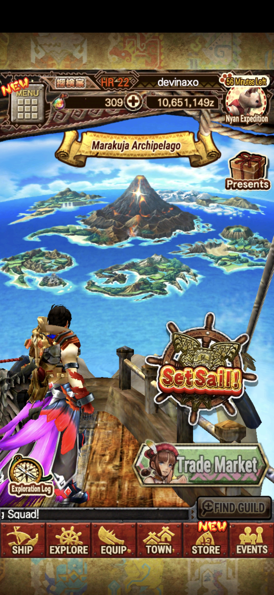</a><br><sub>Home</sub></td>
    <td align="center"><a href="previews/archipelagos.jpg">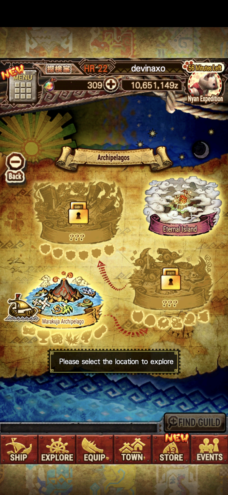</a><br><sub>Archipelagos</sub></td>
    <td align="center"><a href="previews/island.jpg">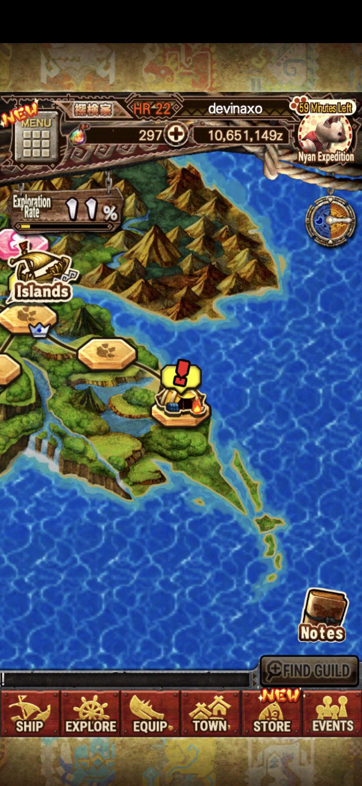</a><br><sub>Island</sub></td>
    <td align="center"><a href="previews/island-map.jpg">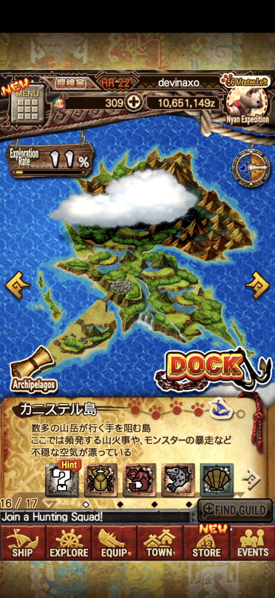</a><br><sub>Island map</sub></td>
  </tr>
  <tr>
    <td align="center"><a href="previews/menu-islands.jpg">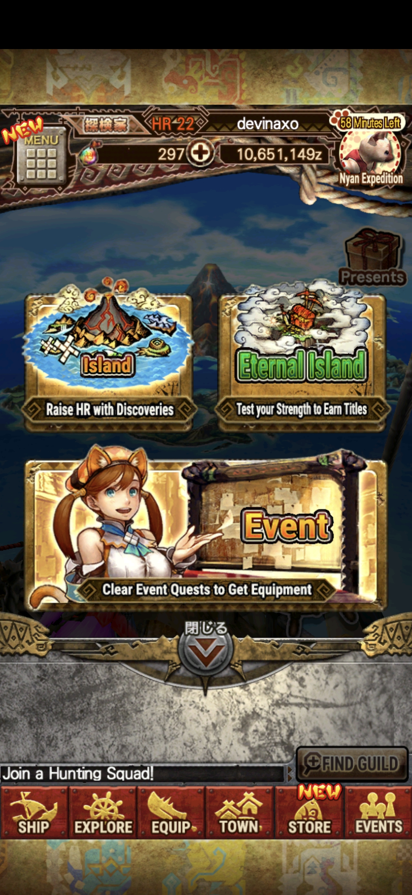</a><br><sub>Island menu</sub></td>
    <td align="center"><a href="previews/quests.jpg">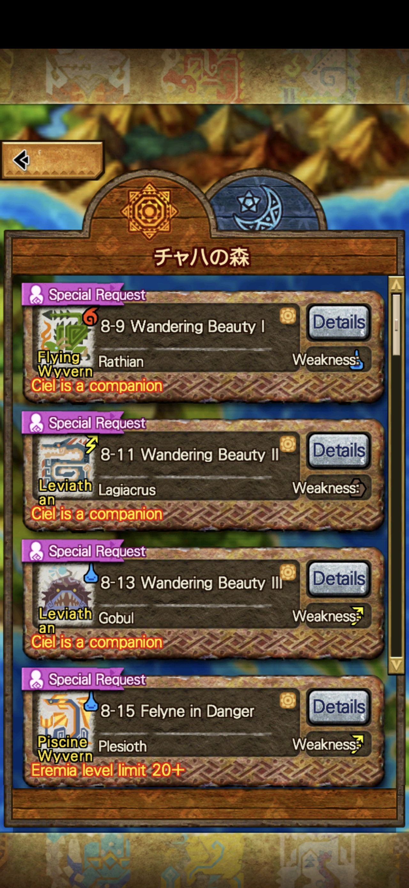</a><br><sub>Quest list</sub></td>
    <td align="center"><a href="previews/event-quests.jpg">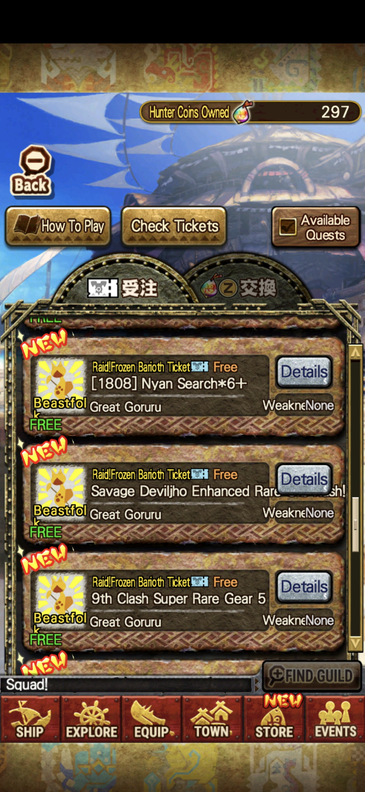</a><br><sub>Event quests</sub></td>
    <td align="center"><a href="previews/equipment.jpg">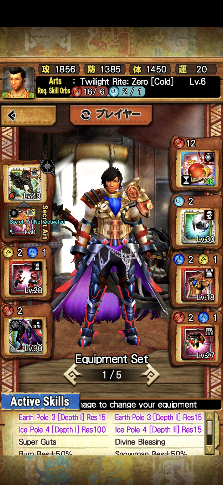</a><br><sub>Equipment</sub></td>
  </tr>
  <tr>
    <td align="center"><a href="previews/equipment-detail-1.jpg">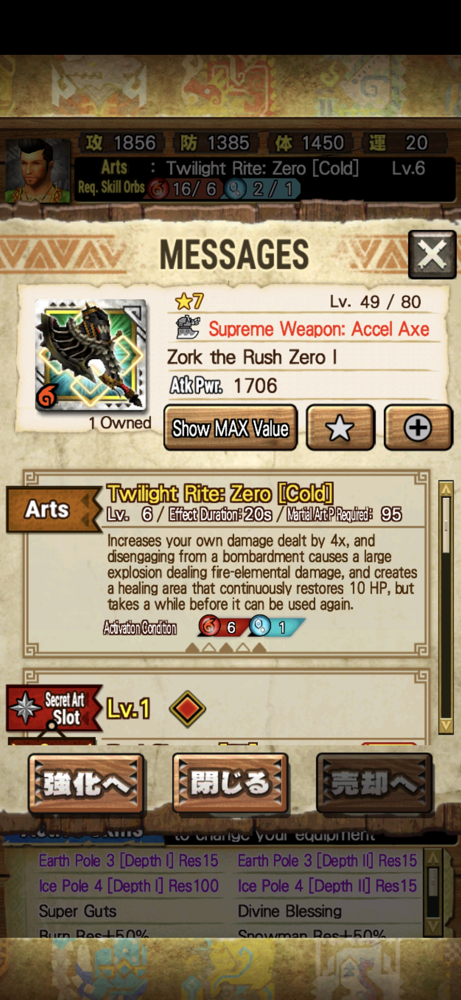</a><br><sub>Equipment detail</sub></td>
    <td align="center"><a href="previews/equipment-detail-2.jpg">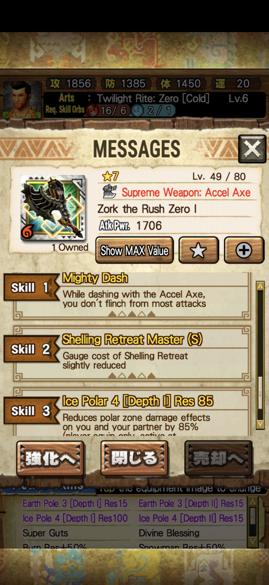</a><br><sub>Equipment detail</sub></td>
    <td align="center"><a href="previews/equipment-evolution.jpg">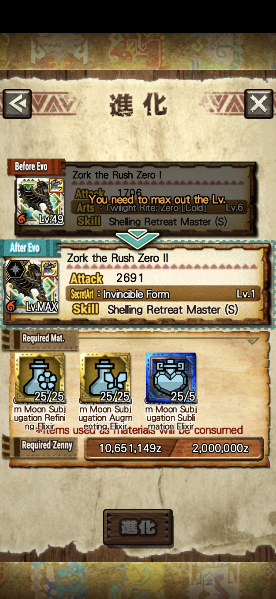</a><br><sub>Equipment evolution</sub></td>
    <td align="center"><a href="previews/trade.jpg">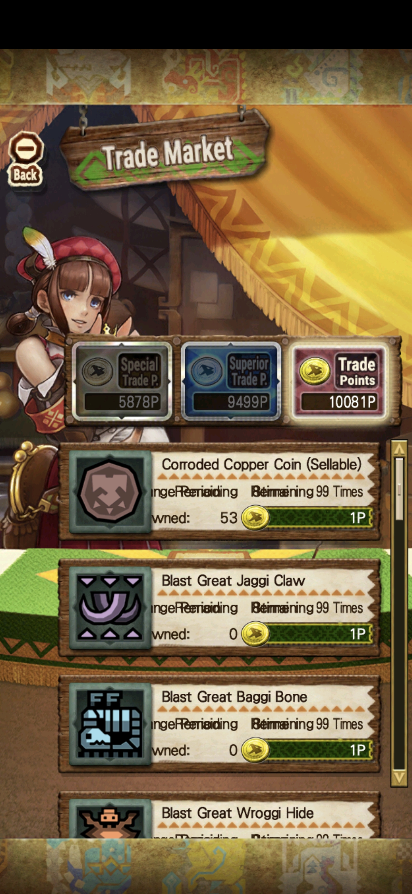</a><br><sub>Trade Market</sub></td>
  </tr>
  <tr>
    <td align="center"><a href="previews/meowxpedition.jpg">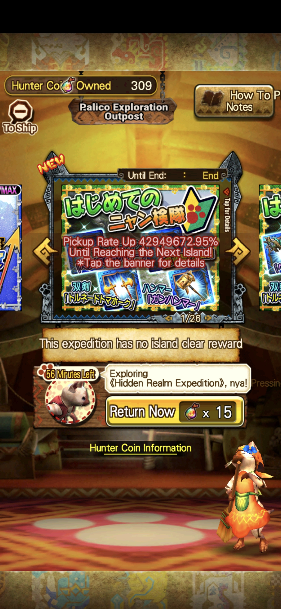</a><br><sub>Nyan Expedition</sub></td>
    <td align="center"><a href="previews/meowxpedition-depart.jpg">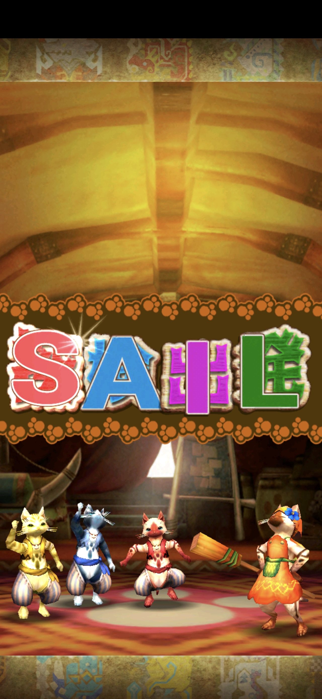</a><br><sub>Nyan Expedition</sub></td>
    <td align="center"><a href="previews/menu-1.jpg">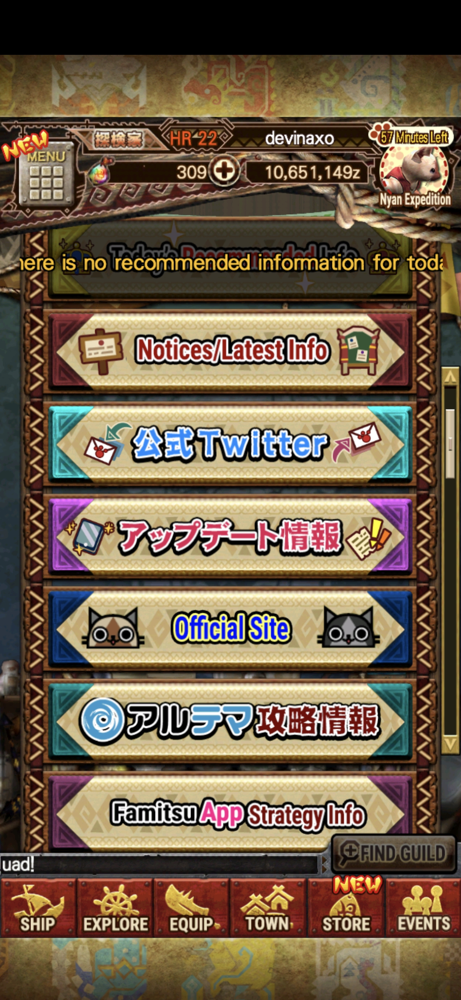</a><br><sub>Menu - notices</sub></td>
    <td align="center"><a href="previews/menu-2.jpg">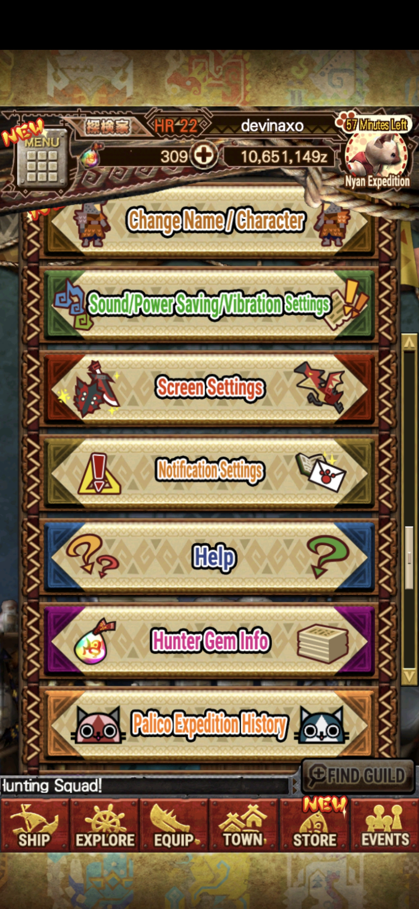</a><br><sub>Menu - settings</sub></td>
  </tr>
  <tr>
    <td align="center"><a href="previews/menu-3.jpg">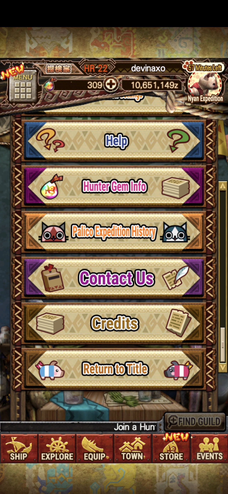</a><br><sub>Menu - help &amp; credits</sub></td>
    <td></td>
    <td></td>
    <td></td>
  </tr>
</table>

## Credits

Translation, reverse-engineering and tooling by **devinaxo**
(GitHub [@devinaxo](https://github.com/devinaxo), Discord `devinacho`).

The ARC / FPK / TEX format work builds on PredatorCZ's
[RevilLib](https://github.com/PredatorCZ/RevilLib), whose `mhxr.ini` documents
this game's archive key, versions and class map.

Capcom's original assets are not included in this repository and are not
redistributed by it.
